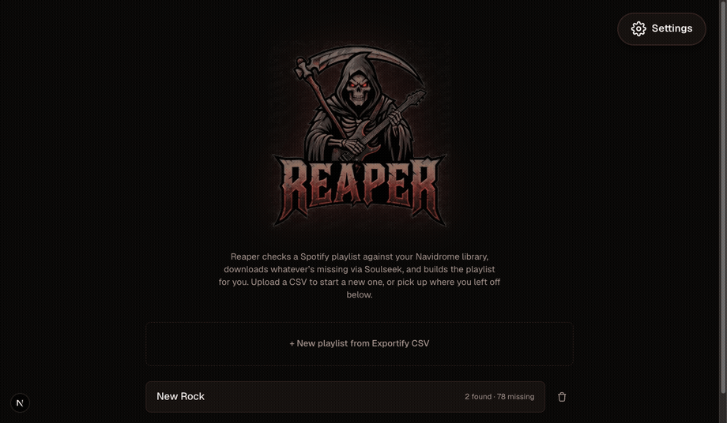

# Reaper — Automated Music Pipeline

Scans your Navidrome library, downloads missing tracks via Soulseek, imports them with beets, and creates or updates playlists — fully automated and playlist-agnostic. Driven by a Next.js + Flask webapp; no CLI required.

Designed to be run on the same server/machine as your navidrome server, files are downloaded to a temporary "incoming" directory, then moved to your main music media directory.



## Why I built this

I had a bunch of Spotify playlists full of music I actually own the right to have — stuff no longer on streaming, bandcamp exclusives, CDs I've ripped — but re-finding and re-downloading every track by hand to get it into my own library was tedious. Reaper automates that loop: point it at a Spotify playlist export, and it figures out what's already in your Navidrome library, sources whatever's missing, and rebuilds the playlist for you, so a library and a playlist just... match. It's a personal tool built for my own homelab setup, but the pipeline (scan → source → import → playlist) is generic enough that it might be useful if you're running Navidrome yourself.

---

## Requirements

- **Python 3** — for the Flask backend (`backend/`) and shared pipeline logic (`core/`). Dependencies: `pip install -r backend/requirements.txt` (Flask, flask-cors, PyYAML).
- **Node.js ≥ 20.9.0** — for the Next.js 16 frontend. The deploy scripts pin `20.20.2` via nvm; see `deploy/setup_frontend.sh`.
- **Docker + Docker Compose** — builds and runs the sockseek (Soulseek client) container; also builds the `.NET 10` SDK/runtime images it depends on (pulled automatically, no local .NET install needed).
- **[beets](https://beets.io/)** — installed separately on the host, imports downloaded tracks into your music library. Not run in Docker; `move_to_library.sh` shells out to whatever `beet` resolves to on `PATH`.
- **A running Navidrome server** — reachable over the Subsonic API, with credentials for `config.yml`.
- **A Soulseek account** — credentials for `config/sldl.conf`. See "A note on Soulseek" below.
- **An Exportify CSV export** of the Spotify playlist(s) you want to pull in.

---

## Getting your playlist CSV

Reaper reads [Exportify](https://exportify.net) CSVs, not Spotify links directly — Spotify doesn't expose playlist contents to third-party tools without going through an export step like this first.

1. Go to **[exportify.net](https://exportify.net)** and log in — it asks you to authorize with your Spotify account (read-only access to your playlists; Exportify runs the export in your browser, it doesn't have its own separate account system).
2. You'll see a list of your playlists (owned and followed/saved). Find the one(s) you want.
3. Click the export/download action next to a playlist to download its CSV — one file per playlist, saved to your browser's normal downloads location.
4. Upload that CSV in Reaper's first wizard step (Upload & Scan).

**Columns Reaper actually needs:** `Artist Name(s)` and `Track Name` are required — a CSV missing either of these (e.g. from a different export tool with different headers) will fail the scan step with a clear error naming what's missing. `Album Name` and `Track URI` are read if present but optional.

**Rank / countdown playlists:** Exportify doesn't export a chart-position column — a playlist's Spotify order is preserved as the CSV's row order, and that's what Reaper falls back to when you don't pick a rank column during upload. If you specifically want numbered ranks (e.g. a "Top 25" countdown) tracked and reported on missing-rank coverage, add a column yourself (e.g. `Rank` with values `1`, `2`, `3`...) to the CSV before uploading, then pick it as the rank column in the upload step.

---

## A note on Soulseek

[Soulseek](https://www.slsknet.org/) is a peer-to-peer file-sharing network and client, run independently since 2001. Reaper doesn't host, index, or provide any files itself — `sockseek` is a headless Soulseek client that searches and downloads directly from other users on the network, the same as the official Soulseek desktop client does.

Files shared over Soulseek are not vetted for copyright status, and downloading copyrighted material without authorization is illegal in most jurisdictions. **Reaper is intended for sourcing music you already own, that's in the public domain, or that's otherwise legally available to download** (e.g. from artists who explicitly permit free distribution). You are responsible for how you use it — see the official [Soulseek rules](https://www.slsknet.org/news/rules) and terms before using the network.

To get an account: download the official client from [slsknet.org](https://www.slsknet.org/) and register a username on first launch — no separate signup step. Reaper doesn't need the desktop client installed to run (it talks to the network directly via `sockseek`), but installing it once is the easiest way to confirm your credentials work and to browse the network yourself.

---

## Directory layout

```
reaper/
├── core/                           ← shared pipeline logic (config, matching, scan, rescan, cleanup, playlist creation)
├── backend/                        ← Flask API, drives core/ + the two shell scripts below
├── frontend/                       ← Next.js wizard UI
├── deploy/                         ← optional systemd deployment scripts (see "Persistent deployment")
├── config/
│   ├── sldl.conf                  ← Soulseek credentials & download settings (gitignored; copy from sldl.conf.example)
│   └── active_search.csv          ← staging file used during downloads (auto-managed)
├── playlists/
│   └── <playlist_slug>/
│       ├── found_tracks.json      ← tracks matched in Navidrome
│       ├── missing_tracks.csv     ← tracks to download
│       ├── meta.json              ← display name, for resuming from the dashboard
│       ├── download_log.txt       ← sockseek output log
│       └── not_found.txt          ← tracks Soulseek couldn't source
├── Dockerfile                     ← builds sockseek image (pinned to release tag)
├── docker-compose.yml
├── config.yml                     ← Navidrome credentials & pipeline settings (gitignored; copy from config.example.yaml)
├── .env                           ← REAPER_MEDIA_ROOT, REAPER_INCOMING_DIR, PUID, PGID (gitignored)
├── download_missing.sh            ← Soulseek download via sockseek (Docker)
└── move_to_library.sh             ← beets import into the Music library
```

---

## Setup

### 1 — config.yml

```bash
cp config.example.yaml config.yml
```

Then edit it with your Navidrome details (or fill these in from the webapp's Settings page after first run):

```yaml
navidrome_url: "http://localhost:4533/"
navidrome_user: "admin"
navidrome_password: "yourpassword"
navidrome_client: "reaper"
navidrome_version: "1.16.1"
match_threshold: 0.80
playlist_order: "desc"   # "asc" = #1 first, "desc" = countdown (#N → #1)
```

### 2 — config/sldl.conf

```bash
cp config/sldl.conf.example config/sldl.conf
```

Then edit it with your Soulseek credentials — see `config/sldl.conf.example` for the full set of keys (bitrate/format preferences, search timing, etc.), most of which are also editable from the webapp's Settings page, which reads/writes this file directly.

`config/sldl.conf` is gitignored, so it's safe to edit directly (or via Settings) whenever your credentials change — e.g. after rotating your Soulseek password — without any risk of committing them. Each person running Reaper keeps their own local copy; only `config/sldl.conf.example` (placeholder values) is checked into the repo.

> **Note:** `desperate = true` is required for reliable results, especially behind CGNAT. It searches by title only and filters by artist on results, which significantly improves hit rate.

### 3 — Docker image

The pipeline builds its own sockseek image from the `Dockerfile` in the project root. The image is built automatically the first time a download runs, and rebuilt only when the `Dockerfile` changes.

The `Dockerfile` clones sockseek pinned to a specific release tag. When upgrading sockseek, update the tag in the `Dockerfile` and run:

```bash
docker compose build
```

> **Background:** sockseek was formerly known as `sldl` and before that `slsk-batchdl`. The project has been renamed and restructured twice. Pinning to a release tag prevents upstream restructures from silently breaking the build between runs.

### 4 — Docker user permissions

The sockseek container must write files as your user, or beets won't be able to read/move what it downloads. Set `PUID`/`PGID` in `.env` (defaults to `1000`/`1000`, the first regular user on most Linux distros, if unset):

```bash
echo "PUID=$(id -u)" >> .env
echo "PGID=$(id -g)" >> .env
```

Also settable from the webapp's Settings page. If it's wrong, the webapp warns and asks for confirmation before downloading rather than silently producing files beets can't move.

### 5 — Media root and incoming folder

Set `REAPER_MEDIA_ROOT` in `.env` (defaults to `/mnt/media` if unset) — the host directory Docker mounts as `/data`, expecting a `Music/` subfolder (your library). Also settable from the webapp's Settings page.

Downloads land in an `incoming/` staging folder before beets imports them — by default a subfolder of the media root, but you can point it elsewhere (e.g. a different/faster disk) with `REAPER_INCOMING_DIR`, in `.env` or the Settings page.

### 6 — Beets config

```bash
cp beets_config.yaml.example ~/.config/beets/config.yaml
```

Then edit the `directory:` path to match your actual media root's `Music/` subfolder, and review the rest — beets handles importing downloaded tracks into your library, and this file lives entirely outside this repo (beets is a separate tool). `chroma`/`acoustid` are optional (better fingerprint-based matching) and disabled by default; enabling them needs a free AcoustID API key, everything else needs no credentials.

### 7 — Script permissions

```bash
chmod +x download_missing.sh move_to_library.sh
```

### 8 — Run it

```bash
python3 backend/app.py          # Flask API on :5001
cd frontend && npm run dev      # wizard UI on :3000
```

### 9 — Persistent deployment on the server (optional)

To run the frontend as a systemd service on the homelab box instead of a
manual `npm run dev` in a terminal, use the scripts in `deploy/`:

```bash
bash deploy/setup_frontend.sh              # installs Node 20 via nvm (Next.js 16 needs >=20.9.0), builds
./deploy/install_frontend_service.sh       # installs + starts the reaper-frontend systemd service (needs sudo)
```

The service listens on port **3002**, not 3000 — the server already has other
Docker containers bound to 3000 and 3001. `NEXT_PUBLIC_API_URL` is baked into
the build at compile time (`frontend/.env.production`, gitignored), so
`setup_frontend.sh` must be re-run (not just the systemd service restarted)
whenever the backend's address changes.

---

## The wizard

The frontend walks through three steps per playlist:

```
1. Upload & Scan
        │  Upload an Exportify CSV, optionally pick a rank column
        │  Searches Navidrome for every track (core/scan.py)
        │  → found_tracks.json, playlists/<slug>/missing_tracks.csv
        ▼
2. Download & Import
        │  Cleans up artist/title strings for Soulseek search hits (core/cleanup.py)
        │  Downloads missing tracks via Soulseek (download_missing.sh → sockseek/Docker)
        │  Imports into the Music library via beets (move_to_library.sh)
        ▼
3. Finalize
        │  Triggers a Navidrome rescan, waits for completion
        │  Re-searches for newly imported tracks (core/rescan.py)
        │  Creates or updates the playlist in Navidrome (core/create_playlist.py)
```

Each step streams live progress (per-track status, download log tail, rate-limit countdowns) to the UI. The dashboard also lists existing `playlists/<slug>/` directories so you can resume a playlist partway through, or delete one that hasn't been imported to Navidrome yet.

**Do not** log into Soulseek locally while a download is running. The Docker container holds the session exclusively; it releases it with a 30-second cooldown after the download step finishes.

---

## Running scripts directly

`download_missing.sh` and `move_to_library.sh` are also runnable standalone (useful in tmux for a long unattended run), independent of the webapp:

```bash
./download_missing.sh --playlist "Hauraki Top 25"
./move_to_library.sh
```

`download_missing.sh` runs its own search-term cleanup pass and `docker compose build` at the start of every run (fast when nothing's changed, thanks to Docker layer cache). Everything else in the pipeline (scanning, rescanning, playlist creation) lives in `core/` and currently has no standalone entry point outside the webapp — trigger those steps from the UI.

```bash
tmux new-session -d -s reaper './download_missing.sh --playlist "Hauraki Top 25"' && tmux attach -t reaper
```

---

## Upgrading sockseek

The `Dockerfile` pins sockseek to a specific release tag. To upgrade:

1. Check the [sockseek releases page](https://github.com/fiso64/sockseek/releases) for the latest tag.
2. Update the `--branch` value in the `Dockerfile`.
3. Rebuild the image:

```bash
cd /opt/reaper
docker compose build --no-cache
```

> **Note:** sockseek was previously named `sldl` and `slsk-batchdl`. GitHub redirects the old URLs to the current repo, but the project structure changed with each rename. Always pin to a release tag rather than `master` to avoid silent breakage between runs.

---

## Troubleshooting

**Soulseek finds nothing**
Make sure `desperate = true` is set in `sldl.conf`. Without it, sockseek searches by combined artist+title string which often returns zero results, especially behind CGNAT.

**Search rate limit hit mid-run**
Reduce `searches-per-time` and `concurrent-searches` in `sldl.conf`. The pipeline will pause and resume automatically — the webapp shows a live countdown — this is normal behaviour.

**Files not moving from incoming after beets import**
Check file ownership — sockseek must run as your user (`PUID`/`PGID` in `.env`, see Setup step 4). Files written as the wrong user cannot be moved by beets. Fix existing files with:
```bash
sudo chown -R $(id -u):$(id -g) <your incoming dir>/
```

**Beets skipping everything**
Clear the incremental state and retry:
```bash
rm -f ~/.config/beets/state.pickle
./move_to_library.sh
```

**Tracks downloaded but not appearing in Navidrome after Finalize**
Check that Navidrome's music folder path covers your media root's `Music/` subfolder. The Finalize step triggers a rescan automatically — if tracks still don't appear, trigger a manual scan in Navidrome → Settings → Library → Scan now.

**Bad artist tags in source CSV**
The cleanup pass automatically handles most common issues: featured artist suffixes, `& The ...` backing band noise, collab separators (`;`, `,`, `feat.`, `with`), and unicode/punctuation hazards. For values that survive cleaning unchanged — typically where the source CSV itself has a genuinely wrong artist name — manual correction is still needed before downloading. Edit `missing_tracks.csv` directly, or fix the source CSV and re-scan.

**Tracks not found on Soulseek**
Check `playlists/<slug>/not_found.txt` after a run. Options for manual sourcing:
- **yt-dlp**: `yt-dlp -x --audio-format flac "ytsearch1:Artist - Title"`
- **Bandcamp**: good for NZ/indie artists
- **CD ripping**: if you own the album

**Docker build fails with `Project file does not exist`**
sockseek has been renamed and restructured twice (formerly `slsk-batchdl` → `sldl` → `sockseek`). If the build breaks after a period of inactivity, check the [sockseek releases page](https://github.com/fiso64/sockseek/releases) and update the `--branch` tag and `.csproj` path in the `Dockerfile` to match the current repo structure, then rebuild with `docker compose build --no-cache`.
